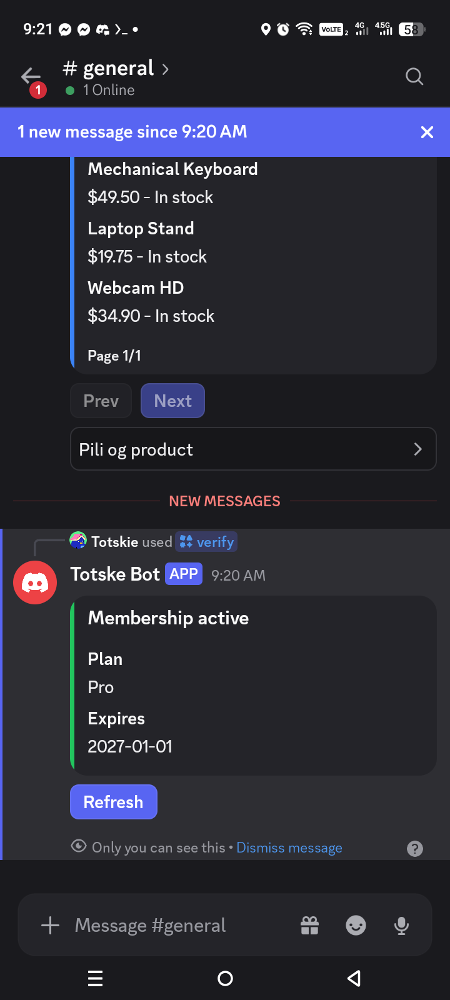
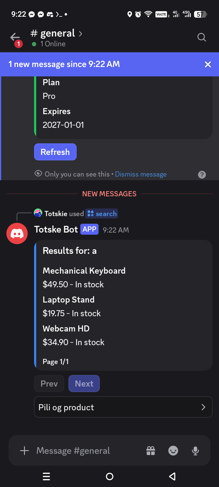
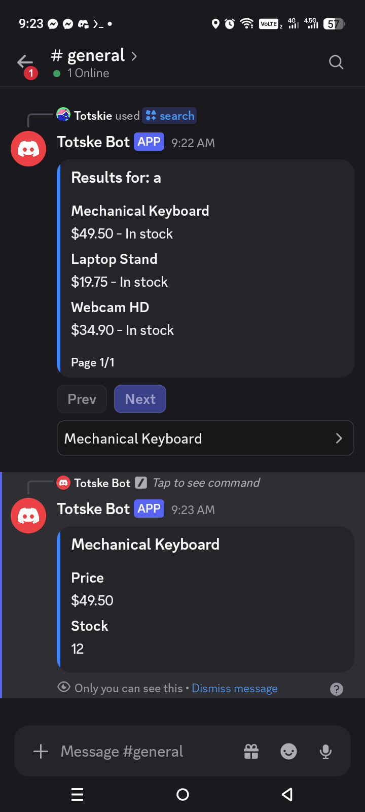

# Discord Bot with REST API Integration

Python Discord bot (discord.py, asyncio, aiohttp) that talks to a REST API.

## Commands
- /ping: health check
- /verify: checks paid membership through the API (embed result)
- /search: searches products through the API (embed result) with Prev/Next buttons and a product dropdown
- /stats: admin-only bot stats

## Run
    pip install -r requirements.txt
    cp .env.example .env   (add your bot token)
    python mock_api.py     (demo API, terminal 1)
    python bot.py sync     (first run, registers commands)
    python bot.py          (normal run)

mock_api.py is a demo API. In real use, point API_URL to your own web app.

## Security

- API key (X-API-Key header) between bot and API, kept in .env
- Set the same API_KEY in .env for bot.py and mock_api.py
- 10 second cooldown per user on /verify and /search
- Admin-only /stats (administrator permission)
- Global error handler: short message to user, details in log

## Screenshots

